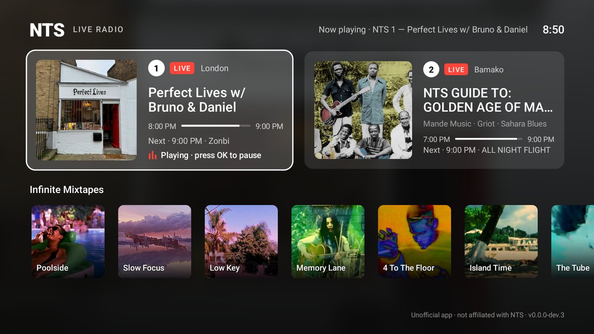

# NTS Radio for Google TV

An unofficial player for [NTS Radio](https://www.nts.live), the London-based online radio station, built for the TV. It works on **Chromecast with Google TV**, **Google TV Streamer** and other Android TV devices.



- **NTS 1 and NTS 2 live**, with the current show, where it's broadcasting from, its genres, how far through it is and what's on next.
- **Infinite Mixtapes**: every NTS mixtape stream, in a row underneath.
- **Remote-friendly**: move with the arrows and press **OK** to listen. Press OK again on the playing station to pause or resume.
- **Keeps playing in the background** and while the screensaver is on. The system's media controls work too.
- **Its own volume** (gear icon, top right): turn NTS down, or up to +12 dB louder than the stream, so it matches your other apps. It's remembered.
- **Dark screen** (moon icon, top right): a black screen with a tiny NTS mark. While music plays it keeps the TV's own screensaver away, and by default it switches on by itself after 5 minutes without a button press (change or turn this off in settings). Any button brings the app back. The mark drifts around now and then so nothing burns into an OLED screen.
- **Recovers from dropouts**: if the stream cuts out it reconnects by itself. After a long pause it rejoins the live broadcast rather than playing stale audio.

> Not affiliated with or endorsed by NTS. It plays NTS's public streams and reads its public schedule API. If you enjoy the station, [support NTS](https://www.nts.live/supporters).

## Install on a Chromecast with Google TV

Download the latest APK from [Releases](https://github.com/barneydobson/nts-tv/releases/latest). You'll need to sideload it, because the app isn't on the Play Store.

1. **Turn on developer mode:** Settings → System → About → select *Android TV OS build* 7 times until it says you're a developer.
2. **Install the free [Downloader](https://play.google.com/store/apps/details?id=com.esaba.downloader) app** from the Play Store (search for "Downloader").
3. **Allow it to install apps:** Settings → Apps → Security & restrictions → Unknown sources → turn on *Downloader*.
4. **Open Downloader and enter this address:**

   ```
   https://github.com/barneydobson/nts-tv/releases/latest/download/nts-tv.apk
   ```

   Then choose *Install*. Once it's installed you can delete the APK file when Downloader offers to.

**NTS Radio** now appears in *Apps → Your apps*. Long-press it to add it to your Favourites.

5. **Lock things back down:** turn *Unknown sources* off again for Downloader (Settings → Apps → Security & restrictions). If you turned on USB or wireless debugging, turn that off too. NTS Radio keeps its own permission to install its updates.

To check an APK is genuine, see [SECURITY.md](SECURITY.md) for the signing certificate's fingerprint.

### Updates

From v1.1.0 the app **updates itself**. When you open it, it checks this repository's latest release, downloads it and checks it's genuine (see below):

- **Nothing playing:** it installs the update straight away. NTS Radio closes; open it again and you're on the new version.
- **Something playing:** an **Update** button appears at the top instead, so your music is never cut off without asking.

The first time it updates, your TV asks whether NTS Radio may install apps. Allow it, and later updates install without asking.

Versions before 1.1.0 can't update themselves: install the latest release once with Downloader (step 4), over the top of the old one.

### Alternative: install from a computer with adb

Turn on developer mode (step 1 above), then go to Settings → System → Developer options and turn on *USB debugging* (or *Wireless debugging* on newer Google TV builds). Find the TV's IP address under Settings → Network & Internet. Then:

```bash
adb connect 192.168.1.50:5555
```

```bash
adb install nts-tv.apk
```

With *Wireless debugging*, pair first with `adb pair <ip>:<pairing-port>` using the code shown on the TV.

### Which Chromecasts does this work on?

It needs a Chromecast that runs apps, meaning **Chromecast with Google TV** (HD or 4K) or **Google TV Streamer**. Older "dongle-only" Chromecasts (1st to 3rd gen, Ultra, Audio) can't install apps. For those, cast from the official NTS app on your phone.

## How it works

| Part | What it does |
| --- | --- |
| `MainActivity` | The TV screen: two live channel cards and the mixtapes row, refreshed every minute from `nts.live/api/v2/live`. |
| `PlaybackService` | A Media3 `MediaSessionService` with ExoPlayer. It plays in the background, retries with backoff when the stream drops, and updates the session's "now playing" info as shows change. |
| `NtsApi` | A small, lenient JSON client for `api/v2/live` and `api/v2/mixtapes`. |

Live streams: `https://stream-relay-geo.ntslive.net/stream` (NTS 1) and `/stream2` (NTS 2). The mixtape stream URLs come from the API.

## Building

Requires JDK 17 and the Android SDK (compileSdk 35).

```bash
./gradlew assembleRelease
```

Without signing secrets, the APK at `app/build/outputs/apk/release/app-release.apk` is signed with your debug key.

### CI and releases

[`.github/workflows/build.yml`](.github/workflows/build.yml) runs on every push. It:

1. Builds a release APK.
2. Smoke-tests it on an Android TV emulator: it launches the app, tunes in to NTS 1, switches to a mixtape, pauses, and checks that playback carries on in the background. Screenshots and logs are uploaded as the `smoke-test-output` artifact, and the latest results from `main` are also kept on the [`smoke-test-results`](https://github.com/barneydobson/nts-tv/tree/smoke-test-results) branch.
3. Publishes a GitHub release with `nts-tv.apk` attached when `main` has a `version.txt` that hasn't been released yet, or when a `v*` tag is pushed.
4. After a release, installs the *previous* release on the emulator and checks it updates itself to the new one (results on the [`update-test-results`](https://github.com/barneydobson/nts-tv/tree/update-test-results) branch).

Release builds are signed with a key stored in two repository secrets: `SIGNING_KEYSTORE_BASE64` (the base64-encoded PKCS12 keystore) and `SIGNING_STORE_PASSWORD`. The key alias defaults to `ntstv`; override it with `SIGNING_KEY_ALIAS` and `SIGNING_KEY_PASSWORD` if needed. Keep the same key forever, or existing installs won't accept updates.

To cut a release, bump the version in [`version.txt`](version.txt) and push to `main`. CI tags the commit and publishes the release once the smoke test passes. Pushing a `v*` tag yourself works too.
